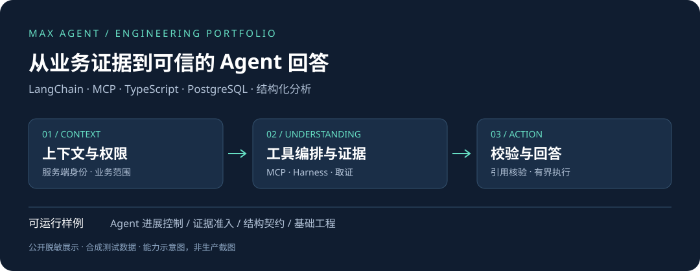

# MAX Agent · AI CRM 工程实践

**嵌入真实 CRM 业务的 Agent：从有权数据取证，到工具编排、结构化分析与可回查回答。**

这是从私有 AI CRM 项目整理的公开求职展示版，重点面向 **Agent / AI 应用开发岗位**。内容包含系统全景、MAX Agent 的关键实现、AI 分析管道与可运行的独立测试。采用全新的展示提交，不迁移私有开发历史。



## 先看这三处

1. **[MAX Agent 技术主线](docs/max-agent.md)**：LangChain + MCP、工具执行 Harness、上下文与权限、证据封装、预算和回答校验。
2. **[AI 分析管道](docs/ai-analysis-pipeline.md)**：长上下文 Map/Reduce、结构化观察、证据核验、持久回执与版本化发布。
3. **[项目全景](docs/system-map.md)**：客户、消息、导入、评分、跟进、管理与异步任务如何支撑 Agent。

## 项目解决什么问题

面向外贸销售团队，将客户档案、WhatsApp 沟通、备注、AI 评估与跟进行动接入同一工作流。销售可以围绕具体客户查资料、核对原文、判断下一步；管理者可以查看团队经营与风险。MAX 进一步让用户以自然语言查询和整理这些有权业务资料。

Agent 面对的是带有角色、客户归属、来源版本与业务口径的数据系统。因此，本项目的重点除了模型调用，还包括工具可执行边界、上下文有效性、证据覆盖、失败恢复与数据库一致性。

## 与 Agent 岗位直接相关的实现

| 能力 | 实际实现重点 | 代码入口 |
| --- | --- | --- |
| Agent 运行时 | LangChain `createAgent`、MCP 工具发现与适配、middleware、有限输出修复 | [runtime](reference/max-agent-runtime.md) |
| 工具编排 | 整批预校验、服务器拥有的上下文、请求级去重、独立超时 | [Tool Harness](reference/max-tool-harness.md) |
| 数据权限与上下文 | 账号重查、客户归属、事务内范围登记、页面快照复核 | [scope & context](reference/max-scope-context.md) |
| 业务检索 | 结构化精确计数、语义候选、续页与范围覆盖 | [query tools](reference/max-query-tools.md) |
| 证据与回答 | 有界 ToolEvidence、引用和实体校验、局部回答与澄清 | [evidence](reference/max-evidence-envelope.md) · [finalization](reference/max-orchestration-finalization.md) |
| 有限执行 | 无新证据时收尾、工具 / 模型 / 证据 / 时间预算 | [运行策略](reference/max-execution-policy.md) · [可运行样例](src/agent-progress.ts) |
| 调用持久化 | Attempt 身份、lease / fence / version、未知结果处理 | [durable attempt](reference/max-durable-attempt.md) |
| 长上下文分析 | single / map / reduce、分层归并、按轮次与预算分块 | [analysis](reference/analysis-map-reduce.md) |
| 结构化结果核验 | 观察和候选分阶段、schema 与来源准入分开 | [grounding](reference/analysis-semantic-grounding.md) |
| 综合评估发布 | 冻结输入、回执持久化、来源代次与有效期复核 | [lifecycle](reference/assessment-lifecycle.md) · [provider execution](reference/assessment-provider-execution.md) |

原项目也包含受控的文档生成、文件读取和行动草稿能力；本展示重点覆盖取证与执行主链，不声明任意自主外发、任意数据库写入或多 Agent 协作。具体生产开关和模型配置未在此核验。

## 技术栈

| 区域 | 原项目技术 |
| --- | --- |
| Agent / AI | LangChain、MCP、模型 provider 适配、Zod 结构化契约 |
| 后端 / 任务 | NestJS、TypeScript、pg-boss |
| 数据 | PostgreSQL、Prisma、事务、持久化运行与回执 |
| 前端 | React 18、Vite、TanStack Query、Tailwind CSS |
| 跨端与验证 | shared 契约包、Vitest、聚焦 PostgreSQL 集成测试 |

## 可独立运行的样例

使用 Node.js 24 和 npm，无需数据库、账号或 API Key。

```sh
npm ci
npm run check
npm run demo
```

| 样例 | 实现 / 测试 | 能观察到的行为 |
| --- | --- | --- |
| MAX 进展控制 | [代码](src/agent-progress.ts) · [测试](tests/agent-progress.test.ts) | 无新证据收尾、进展计数重置、轮数与调用上限 |
| AI 证据准入 | [代码](src/evidence-grounding.ts) · [测试](tests/evidence-grounding.test.ts) | 拒绝虚构 ID、未来材料、未允许的备注 |
| AI 观察契约 | [代码](src/semantic-observation.ts) · [测试](tests/semantic-observation.test.ts) | 拒绝额外系统字段、无依据因素与重复引用 |
| 前端请求合并 | [代码](src/customer-grade-loader.ts) · [测试](tests/customer-grade-loader.test.ts) | 同轮去重、分片、失败传播、实例隔离 |
| 日历日期 | [代码](src/calendar-date.ts) · [测试](tests/calendar-date.test.ts) | 闰年、低年份、无效输入与范围边界 |
| 并发锁键 | [代码](src/inbound-identity-locks.ts) · [测试](tests/inbound-identity-locks.test.ts) | 稳定获取顺序、空标识归一化 |

`src/` 与 `tests/` 为独立可运行样例；`reference/` 是依赖原项目的真实源码节选，供代码审阅，未纳入独立样例的测试通过结论。`demo` 使用合成数据演示局部机制，不调用模型、不连接原 CRM，也不替代原系统集成验收。

## 面试讨论路线

- **15 分钟：** [MAX 主线](docs/max-agent.md) → runtime → Harness → finalization。
- **深入讨论：** 何时停止继续取证？候选数为何不能当匹配总数？schema 正确为何仍需核实证据？模型结果未知时为什么不能盲目重试？
- **全栈背景：** [架构](docs/architecture.md)、[业务全景](docs/system-map.md)、[成交事务](reference/crm-commercial-transaction.md)与[四个基础工程案例](docs/engineering-cases.md)。

项目描述与代码不替代个人贡献说明。候选人在面试中据实说明负责范围、协作方式和 AI 辅助开发过程；本仓库不声明独立完成全部代码，不虚构性能、客户规模或商业成果。

## 来源与公开范围

代码由实际项目按文件和函数白名单抽取；示例数据全部合成；移除了业务连接、生产地址、凭据和私有资料，未迁移 Git 历史。概览图是架构示意，非生产界面截图。具体改动、验证范围及未纳入内容见[来源与脱敏说明](docs/publication-scope.md)。

仓库未附加开源许可；公开展示不等同于另行授予商业使用许可。
