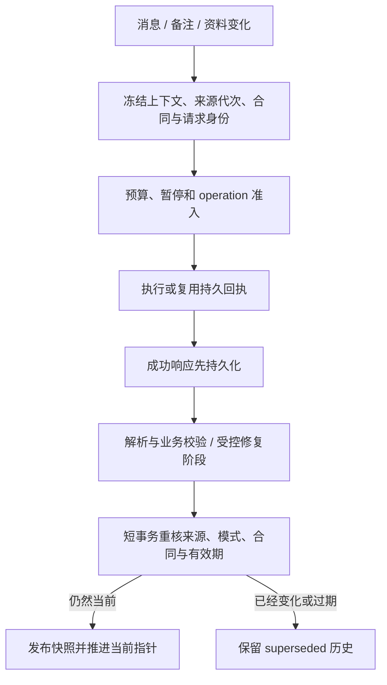

# AI 分析管道：长上下文、证据与发布一致性

AI 分析与 MAX 是互相连接但职责不同的链路：分析将业务材料组织为结构化结果；MAX 读取当前有权结果并按问题补读证据。两者共享部分契约，不共享一份可以任意写入业务事实的模型状态。

原项目同时保留长上下文分析链和综合评估 V2。下面分别说明，不把 Map/Reduce、旧规则合成和 V2 发布混成一条所有请求都会经过的通路。具体路由取决于代码和运行配置；本展示不核验线上启用状态。

## 路径 A：单次 / 增量 / 重建分析与 Map/Reduce

[实际代码](../reference/analysis-map-reduce.md)展示如何选择分块、并发调用 map、将中间结果分批 reduce，以及按会话轮次组织消息。输入预算不是简单截取前若干条消息；阶段状态、证据和上下文覆盖仍要能解释。模型和媒体调用不能被放入长期客户写锁内。

[语义结果处理](../reference/analysis-semantic-grounding.md)将 map 阶段的 observation 与 single/reduce 阶段 candidate 分开；错阶段输出、非法结构或不在冻结输入范围的引用会明确降级。支持、阻碍和缺失信息可以用自然语言描述，但来源身份、系统元数据和有限影响由程序掌握。

## 路径 B：综合评估 V2 的独立生命周期

[生命周期源码](../reference/assessment-lifecycle.md)与[付费操作主体](../reference/assessment-provider-execution.md)对应不同职责：service 管来源、校验与发布；executor 管持久操作身份、准入和回执。成功响应落库之后发生的数据库恢复，不应变成重复调用模型。未知结果不能按“没有发生”处理。

发布时重新核对 source generation、合同、模式和 active run。过期回执描述的是原冻结 asOf，不因延迟发布而获得新的有效期。短事务内只做一致性检查和数据库写入，模型调用在事务外。

V2 的结构化评估可以包含主分，最终等级由程序按阈值映射；它与路径 A 的模型观察阶段不是同一个输出契约。不能用“模型永远不能输出任何分数”概括两条路径。

## 三类验证不可互相替代

| 验证 | 能说明什么 | 不能单独说明什么 |
| --- | --- | --- |
| Zod schema | 字段、类型、枚举、数量、格式符合约定 | 引用真实、原文支持结论 |
| 来源与时点准入 | 引用属于冻结材料，备注允许参与 AI，未超出 asOf | 输入材料本身完整、模型推断一定正确 |
| 发布事务与版本条件 | 结果不会沿旧来源无条件覆盖当前指针 | 模型业务质量、线上吞吐或真实费用 |

## 可运行验证

- [观察 schema](../src/semantic-observation.ts)及[测试](../tests/semantic-observation.test.ts)：禁止模型在观察阶段注入系统字段、拒绝无证据因素和重复引用。
- [来源准入](../src/evidence-grounding.ts)及[测试](../tests/evidence-grounding.test.ts)：拒绝虚构 ID、未来材料、不可参与 AI 的备注；reduce 只继承其 map 观察的引用。

可运行样例采用最小上下文子集。完整源代码中的持久回执、事务竞争、RLS 与 provider 行为依赖原项目设施，本仓库未运行这些集成验证。原项目存在针对它们的测试，不能把“存在测试”写成“本次已经通过”。
