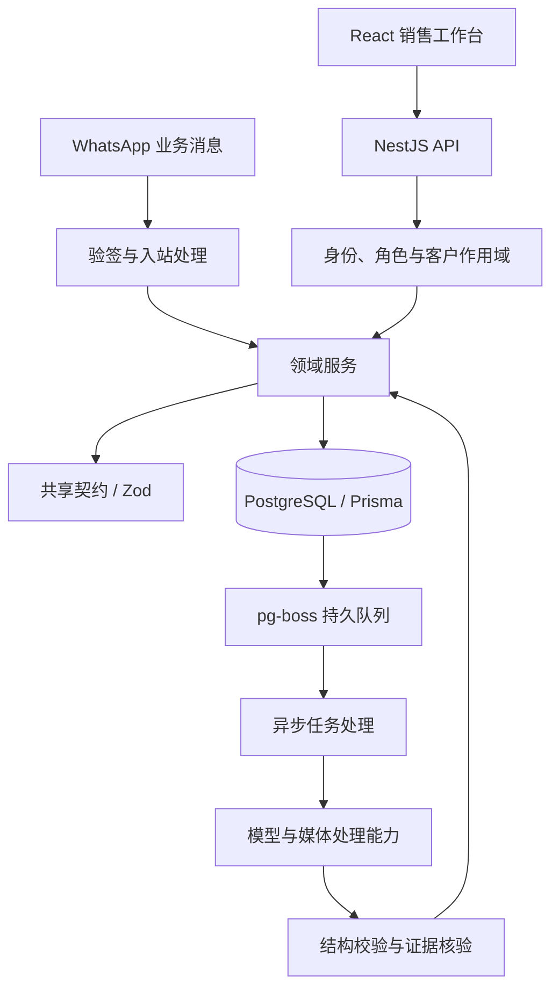

# 技术架构与责任边界

下图概括原项目的主要责任分层，不包含生产地址、部署配置或完整内部拓扑。公开样例只覆盖其中的局部实现，不构成完整 CRM。

## 原项目的组织方式

| 模块 | 责任 |
| --- | --- |
| Web | 工作台、查询状态、表单、导航和角色体验 |
| API | 身份验证、领域授权、客户与消息业务、外部集成 |
| Shared | 跨端类型、请求与响应契约、纯业务函数 |
| 数据层 | 模型、迁移、约束、事务与审计记录 |
| 任务层 | 分析、翻译、媒体处理等耗时工作及恢复 |

这是逻辑分层图。原项目 API 和主要 pg-boss worker 位于同一 Node 进程，并非图中每个节点都独立部署。

## 三条关键链路

### 客户等级显示

多张客户卡片请求当前等级 → 每个账号独立的 loader 合并同轮请求 → API 验证身份并筛选客户作用域 → 读取当前摘要 → 前端逐项分发。

[公开 loader](../src/customer-grade-loader.ts)保留调度与分发逻辑，`fetchGrades` 通过参数注入。它不承担身份验证，也没有长期缓存。换账号时应创建新实例，调用方还须阻止旧账号的晚到响应更新当前界面。

### 消息入站与并发身份

入站消息 → 验签 → 根据消息及非空身份标识生成稳定锁键 → 调用方在事务内依序获取数据库锁 → 核实身份并持久化 → 安排后续处理。

[锁键函数](../src/inbound-identity-locks.ts)只负责生成有序键。稳定顺序有助于统一竞争资源的获取顺序；完整系统仍需唯一约束、事务、冲突处理与幂等，不能用该纯函数替代它们。

### AI 观察与业务决策

有权读取的业务上下文 → 模型返回观察 → 严格校验结构 → 服务端核实引用、权限与证据 → 规则与业务服务形成结果 → 界面展示依据与下一步。

[观察契约](../src/semantic-observation.ts)允许描述支持因素、阻碍因素、不确定性、缺失信息和矛盾。此阶段不接受模型写入评分或系统元数据。引用格式正确不代表引用真实，也不代表结论得到支持。

## 设计取舍

- 用共享契约缩小跨端漂移；授权和事实校验留在服务端。
- 日历日期使用严格字符串与品牌类型；需要时间戳时再显式转换。
- 用持久状态、事务与幂等处理异步副作用；不把内存中的“已处理”当作可靠事实。
- 明确区分加载、空结果、不可用与失败，避免把缺失数据展示为肯定结论。
- AI 产生可复核的观察与建议；权限、外部发送、费用和数据写入由确定性程序边界约束。
