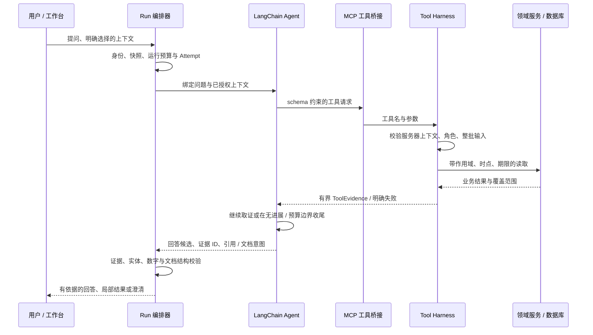

# MAX Agent：业务工具、证据与有界执行

MAX 是嵌入 CRM 工作台的业务 Agent：围绕当前用户的问题，按权限读取客户、对话、跟进、评估与经营资料，将工具结果组织成可回查的回答，也支持受控的文件与行动草稿能力。原项目实际使用 LangChain `createAgent` 和 MCP；本展示不把它包装成多 Agent 系统，也不声明任意自主操作能力。

## 一轮请求的责任链

## 代码阅读顺序

| 顺序 | 源码节选 | 面试讨论点 |
| --- | --- | --- |
| 1 | [Agent + MCP runtime](../reference/max-agent-runtime.md) | 工具发现、LangChain 适配、middleware、收尾与有限修复 |
| 2 | [Tool Harness](../reference/max-tool-harness.md) | 整批预校验、请求级缓存、独立超时、销售读审计 |
| 3 | [ToolEvidence](../reference/max-evidence-envelope.md) | 明细 / KPI 区分、字节限制、coverage、untrusted_data |
| 4 | [业务查询工具](../reference/max-query-tools.md) | 结构化精确总数与语义候选的区别、续页引用失效 |
| 5 | [账号与上下文](../reference/max-scope-context.md) | 运行中权限复查、客户归属、页面快照与证据身份 |
| 6 | [预算和冻结策略](../reference/max-execution-policy.md) | 模型 / 工具 / 证据 / 时间预算、配置漂移 |
| 7 | [持久 Attempt](../reference/max-durable-attempt.md) | lease、fence、版本、未开始 / 已开始 / 未知结果 |
| 8 | [编排与最终校验](../reference/max-orchestration-finalization.md) | 服务器拥有的工具上下文、最终引用与文档意图校验 |

## 设计中值得展开的几件事

### 工具不是直接访问数据库的模型后门

工具定义包含输入输出 schema、只读声明、超时、行数与 evidence 映射；工具调用仍委派领域服务。actor、role、runId、asOf 和业务规则身份由服务器注入。模型不能通过参数自行选择更高角色。客户范围登记还会在事务中复查归属，账号被禁用或角色变化不能继续沿旧运行身份读取。

### 检索、原文和语义结论是不同阶段

结构化条件查询可以返回受范围约束的精确总数；语义检索先发现候选，再按相关区域读取原文核实。候选池被限制、分页未读完和证据不完整都需要保留覆盖说明，不能把某页候选数当作全量语义匹配数。查询引用过期或权限变化时重建合法范围，不改 offset 或删 token 来猜读。

### 上下文与提示注入边界

页面、客户消息和文件内容都是资料，不授予新的执行权限。服务端绑定页面查询身份；需要业务事实时，工具重新读出本轮证据。提示词中的 untrusted_data 声明只是表达层约束，必须与工具白名单、schema、身份和数据作用域共同工作。

### 有限执行与可解释的失败

`createAssistantAgentProgressTracker` 以服务器拥有的证据 revision 检查进展：连续无新增证据会进入收尾；即使一直有进展，也受到工具决策轮数和模型调用数限制。运行预算另行限制证据字节、行数、工具执行次数与期限。有限结构修复不是对未知付费调用的无条件重试。

超时使用 AbortController 并吸收迟到结果；它不保证任意依赖真的停止。可复用的工具 trace 是 best-effort，销售读取的 before/after 审计是独立硬约束，不能把两者混为一谈。

### 最终回答不是模型原文直出

候选回答中引用的 evidenceId、客户实体和消息引用必须对应本轮有权证据；经营数字通过相应读模型核实。文档表格从证据绑定数据，不允许模型随意提供明细行。未通过的候选进入受限修复或已有证据的局部回答，不补造业务事实。

## 可运行的小实验

运行 `npm run demo` 或阅读[进展控制测试](../tests/agent-progress.test.ts)：可以观察无新增证据时的收尾、证据增长后的计数重置、决策轮数上限和非法 revision 拒绝。这个实验不发起模型调用，也不代表执行了完整 MAX 或数据库授权验收。

## 本展示没有声称的结论

未在此公开生产凭据、运行参数、真实对话或客户信息；没有用静态源码推断生产已启用的模型、检索召回率、吞吐量或端到端延迟。实时通话旧试用已退役，不作为当前 MAX 展示能力。
